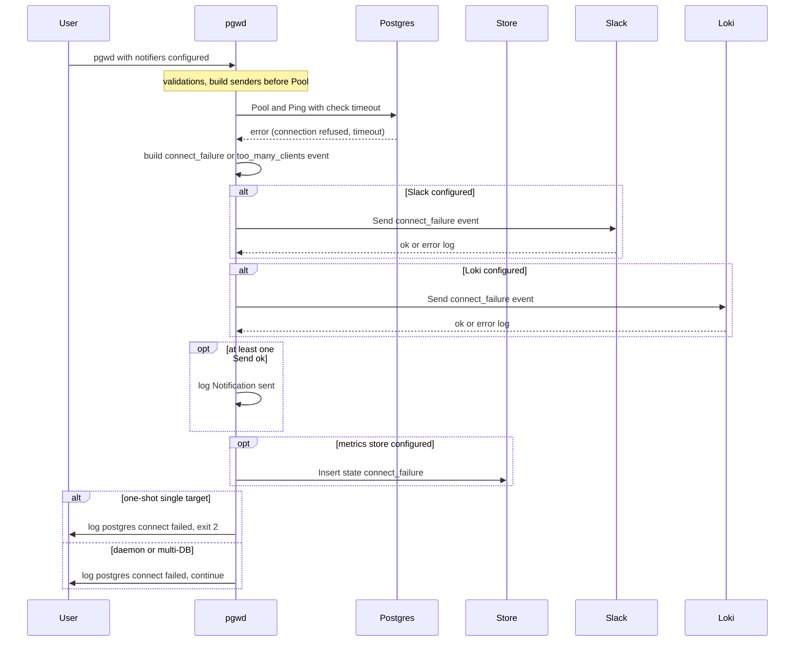

# Sequence: Connection failure — notify (and exit only in one-shot)

When Postgres connection fails and at least one notifier is configured, pgwd **always** sends a connect-failure event (or `too_many_clients` if the error is "too many clients already") to all notifiers. No extra flag is required.

- **One-shot** (`interval == 0`), single target: log and **exit 2**.
- **Daemon** (`interval > 0`): log, persist `connect_failure` when a metrics store is configured, and **continue** to the next tick (no process exit). Multi-DB always logs and skips the failed target.

**Slack:** connect_failure is sent with attachment color `danger` (red bar). Threshold-exceeded events use `warning` (yellow bar).

**See also:** [01-startup-validation](./01-startup-validation.md) (startup flow including this failure path).
